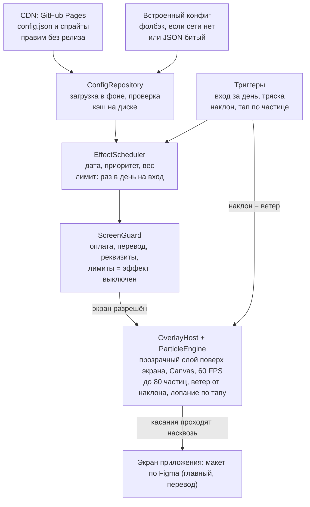

# Screen Saver — план и разбор ТЗ

16 октября 2026 · Хакатон Сбер × НИУ ВШЭ «Создаем эмоции», трек A «Приколы»

> Это план, составленный в начале хакатона. Что уже сделано и как запустить, смотрите в [README](../README.md).
> С тех пор поменялось одно решение: прототип пишем на чистых HTML, CSS и JS, а не на Swift или Kotlin.

## Коротко

Идея проходит по треку A «Приколы» и почти совпадает с «хорошим примером» из ТЗ. Но если анимация только показывается при входе, баллы снимут как за одноразовый прикол. Поэтому делаем сезонный слой, который управляется контентом с CDN и на который ребёнок может влиять сам: трясти телефон, наклонять его, тапать.

- **Хакатон:** Сбер × НИУ ВШЭ «Создаем эмоции», детское приложение СберKids. Старт 16 октября, консультация 17 октября, код сдаём до 15:00 18 октября.
- **Трек:** A «Приколы», команда платформы. Это интерактивный слой поверх основных сценариев приложения.
- **Наша идея:** при заходе в приложение поверх экрана идёт праздничная или сезонная анимация: ёлка и снег на Новый год, листопад осенью, цветы весной и т. д. Набор эффектов и даты лежат в JSON на CDN, поэтому новый праздник добавляется без релиза приложения.
- **Время:** около 1,5 дня. Из этого следует: один движок частиц, 5–6 эффектов в виде конфигов и одна платформа.

ТЗ взято с [сайта хакатона](https://kids.hackathon.aam.run/#tracks). Файл по [ссылке на СберДиск](https://files.sberdisk.ru/s/naNGxAow5QUGa7G) открывается только в браузере, автоматически скачать его не вышло. Если в нём есть что-то сверх сайта, документ нужно сверить с ним.

## Анализ ТЗ

Больше всего баллов даёт виральность (30 из 100), а следом идут соблюдение ограничений и реализуемость (по 25). Значит, эффект должен вызывать «вау» и желание показать другу, но при этом выглядеть как то, что команда Сбера может завтра встроить в приложение.

### Критерии оценки и что они значат для нас

| Критерий | Вес | Чем забираем баллы |
| --- | --- | --- |
| Виральность | 30 | Интерактив: наклон меняет ветер, тряска стряхивает снег, по тапу лопается снежинка или шарик. Секретные пасхалки, которыми дети делятся друг с другом |
| Соответствие требованиям | 25 | Не блокируем тапы, выключаемся на платёжных экранах, 0+/6+, без брендов и поп-культуры |
| Реализуемость | 25 | Нативный стек из ТЗ, без новых зависимостей, 60 FPS, запуск не замедляется, битый конфиг ничего не ломает |
| Управляемость контентом | 10 | Все праздники, даты, спрайты и веса лежат в JSON на CDN. На демо правим JSON, и эффект меняется без пересборки |
| Подача | 10 | Демо на телефоне и дебаг-меню с выбором даты, чтобы показать все праздники за минуту |

### Жёсткие правила трека A

- Прикол — это слой поверх, а не ещё один экран на пути пользователя. Ввод не блокируется дольше, чем длится эффект, а лучше не блокируется совсем.
- Нельзя перекрывать экраны оплаты, перевода, реквизитов и лимитов.
- Нельзя замедлять запуск приложения и главный экран.
- Одноразовый прикол снижает баллы, поэтому эффект должен повторяться и меняться.
- Желательно менять контент через CDN без релиза. Это сердце нашей идеи.

### Общие ограничения, которые нас касаются

- **Без бэкенда.** Можно только JSON и статику по HTTPS, так что конфиг кладём на GitHub Pages.
- **Стек.** Android: Kotlin, Compose, Lottie, Coil, OpenGL ES. iOS: Swift 6, SwiftUI, Lottie, Metal. Кроссплатформа не принимается, новые библиотеки требуют согласования. Для прототипа стек любой, но натив даёт баллы за реализуемость.
- **Кода приложения не дадут.** По [макетам в Figma](https://www.figma.com/design/Dn9afPitsdKxwGMpUvK96Z/SberKids?node-id=0-1&t=CuOVoKAZfBiHAVYH-1) делаем макет-оболочку: главный экран и экран перевода.
- **Бюджеты.** Анимация держит 60 FPS, файлы приколов весят не больше 6 МБ, приложение вырастает не больше чем на 3 МБ.
- **Контент 0+/6+.** Без сторонних брендов, поп-культуры и Сберкота, без тёмных паттернов и обратного отсчёта.
- **Безопасность.** Никакой аналитики и сторонних SDK. Пустой или битый конфиг не должен ломать приложение.

### Что сдать (иначе работу не оценят)

- [ ] Публичный репозиторий, ссылка в [общей таблице](https://docs.google.com/spreadsheets/d/1citg00WesqXX21FukhZUDgMMQGMNAL6usle9Afi6r8o/edit?gid=0#gid=0) до 15:00 18 октября
- [ ] Презентация: решение, как оно работает, что берём из приложения и что нужно построить
- [ ] Рабочий прототип, который показываем на реальном телефоне

Вопросы по макетам и реализуемости задаём в Telegram @MooonLoone.

## Продукт: что видит ребёнок

Ребёнок открывает приложение, и поверх главного экрана на 5–8 секунд идёт праздничная анимация. Пока она идёт, все кнопки нажимаются. Потом анимацию можно вернуть тряской телефона и управлять ею наклоном.

### Сценарии (триггеры)

1. **Первый вход за день.** Анимация стартует после того, как главный экран отрисовался, и не чаще одного раза в день, чтобы не надоесть.
2. **Тряска телефона.** Анимация запускается снова в любой момент на некритичном экране, как в примере из ТЗ.
3. **Наклон.** Частицы «сдувает ветром» в сторону наклона. Это главный «вау» на демо.
4. **Тап по частице.** Снежинка, шарик или лист лопается с вибрацией. Тап должен проходить дальше в приложение, если под ним кнопка.
5. **События (nice-to-have).** Конфетти на пополнение, выполненное дело или «красивое» число на балансе, например 777 ₽. Сумма не покидает устройство.
6. **Пасхалка (nice-to-have).** Долгое нажатие на аватар или 5 тапов по логотипу включает секретный эффект. За счёт таких секретов дети рассказывают друг другу об эффектах, а это и есть виральность.

### Календарь эффектов (первая версия)

Религиозные и потенциально спорные праздники (Хэллоуин и т. п.) пока не берём из-за рамки 0+/6+. Персонажей вроде Деда Мороза не делаем, только предметы и природу.

| Эффект | Когда | Что на экране | Приоритет |
| --- | --- | --- | --- |
| Новый год | 20 декабря – 10 января | Снег, ёлка в углу, гирлянда над шапкой, по тапу зажигаются огни | MVP |
| Осень | сентябрь – ноябрь | Листопад, наклон даёт ветер | MVP (сейчас октябрь, покажем вживую) |
| Зима | декабрь – февраль | Снегопад | MVP (тот же спрайт, что и для Нового года) |
| Весна / 8 марта | март – май | Лепестки и цветы | MVP |
| День космонавтики | 12 апреля | Звёзды и ракета, которая пролетает по тапу | Nice-to-have |
| День защиты детей / лето | 1 июня, июнь – август | Мыльные пузыри, лопаются по тапу | Nice-to-have |
| День знаний | 1 сентября | Конфетти и шарики | Nice-to-have |
| День рождения ребёнка | дата из профиля, только локально | Шарики и конфетти | Nice-to-have |

### Правила поведения

- Оверлей пропускает все касания сквозь себя, контент не блокируется ни на миллисекунду.
- На экранах оплаты, перевода, реквизитов и лимитов эффект плавно исчезает и там не запускается.
- Анимация начинается через 300–500 мс после первого кадра главного экрана. Конфиг грузится в фоне и не задерживает запуск.
- Если в системе включено «Уменьшение движения», частиц становится меньше или остаётся статичный декор.
- Звук сам не включается, есть только лёгкая вибрация на тап.

## Кто делает дизайн эффектов

Да, Claude может сделать все эффекты MVP, если рисовать их кодом: движок частиц плюс простые векторные спрайты в плоском стиле. Сложные рисованные иллюстрации и персонажная анимация выйдут слабее, чем у дизайнера. Их лучше не планировать вообще.

| Что нужно | Claude | Как |
| --- | --- | --- |
| Снег, листопад, конфетти, лепестки, звёзды, пузыри | Да, полностью | Движок частиц на Canvas 2D: физика, ветер, вращение, покачивание. Параметры задаются в JSON |
| Спрайты: снежинка, кленовый лист, ёлка, шарик, ракета, гирлянда | Да, в простом плоском стиле | Рисуются кодом на Canvas под палитру из Figma и Pinterest, файлы картинок не нужны |
| Гирлянда с мигающими огнями, сияние, вспышки | Да | Процедурная анимация в коде |
| Простая Lottie-анимация (качание, появление) | Частично | JSON можно написать вручную, но то же самое дешевле сделать через движок |
| Сложная иллюстрация, персонаж с мимикой | Нет | Нужен дизайнер или готовая Lottie со свободной лицензией. На хакатоне не делаем |
| Звуки | Нет | В приложении уже есть готовые звуки и вибрация, в презентации ссылаемся на них |

Ограничение для Claude: анимация пишется вслепую. Нужен человек с телефоном, который запускает сборку и присылает скриншот или видео, иначе скорость, размер и плотность частиц не подобрать. Стиль (палитру, скругления, толщину линий) берём из Figma СберKids, чтобы эффекты выглядели частью приложения.

## Архитектура

Решение команды: прототип на чистых HTML, CSS и JS, без библиотек и без запросов наружу. Сначала планировали натив (Swift или Kotlin), но от него отказались. Слой — это `<canvas>` поверх экрана с `pointer-events: none`, датчики берём из `deviceorientation` и `devicemotion`. В реальном приложении тот же слой можно показать прозрачным WebView поверх экрана или перенести логику на нативный Canvas: конфиг и правила от этого не меняются.



Идея схемы: вся логика «что и когда показать» лежит в конфиге, а приложение содержит один универсальный движок. Это и есть ответ на вопрос презентации «что нужно построить».

### Модули

Ниже модули из схемы. В коде они живут функциями внутри [web/js/seasonal.js](../web/js/seasonal.js), а не отдельными классами.

- **OverlayHost** — `<canvas>` поверх экрана с `pointer-events: none`. Тапы слушаются на `document` в фазе захвата без отмены, поэтому кнопки под снегом нажимаются.
- **ParticleEngine** — частицы, физика (гравитация, ветер, вращение, покачивание) и отрисовка через `requestAnimationFrame`. Цикл кадров работает только во время показа.
- **ConfigRepository** — грузит `config.json` в фоне, проверяет его и кэширует в `localStorage`. При любой ошибке берёт кэш или встроенную копию, а если нет и её, просто не показывает эффект.
- **EffectScheduler** — по дате (или подменённой из панели отладки) выбирает эффект. Праздник важнее сезона, среди равных побеждает больший `priority`. Лимит «раз в день» хранится в `localStorage`.
- **Триггеры** — `devicemotion` для тряски (порог 18 м/с²) и `deviceorientation` для наклона (угол gamma превращается в ветер). На iPhone браузер даёт датчики только после разрешения, слой запрашивает его при первом тапе.
- **ScreenGuard** — `Seasonal.setSuppressed(true)` на критичном экране. Слой гаснет за 200 мс и не запускается, пока экран открыт.

### Пример конфига

```json
{
  "version": 1,
  "maxParticles": 80,
  "effects": [
    {
      "id": "new_year",
      "dates": { "from": "12-20", "to": "01-10" },
      "priority": 100,
      "triggers": ["first_open_of_day", "shake"],
      "durationMs": 7000,
      "particles": [
        { "sprite": "snowflake.png", "count": 60, "speed": [40, 90],
          "size": [10, 24], "spin": true, "tiltWind": true, "tapToPop": true }
      ],
      "decor": [
        { "sprite": "tree.png", "anchor": "bottom_end", "widthPct": 30 },
        { "sprite": "garland.png", "anchor": "top", "blink": true }
      ]
    },
    {
      "id": "autumn",
      "dates": { "from": "09-01", "to": "11-30" },
      "priority": 10,
      "triggers": ["first_open_of_day", "shake"],
      "durationMs": 6000,
      "particles": [
        { "sprite": "leaf_maple.png", "count": 30, "speed": [30, 70],
          "size": [18, 36], "sway": true, "tiltWind": true }
      ]
    }
  ],
  "criticalScreens": ["payment", "transfer", "requisites", "limits"]
}
```

Спрайты лежат рядом с конфигом на CDN и кэшируются. На весь набор ожидаем меньше 1 МБ при лимите 6 МБ.

## План на 1,5 дня

К вечеру 17 октября всё из MVP должно работать на телефоне. Утро 18-го оставляем только на презентацию и демо, новые фичи тогда не делаем.

| Когда | Этап | Что делаем |
| --- | --- | --- |
| 16 окт, вечер | Подготовка | Выбрать стек (выбрали чистый HTML/CSS/JS), публичный репо, GitHub Pages, пример «Новый год» (сделан) |
| 17 окт, 10–14 | Каркас | Экраны по Figma, OverlayHost, движок частиц, первый снег на телефоне |
| 17 окт, 14–20 | Эффекты | Конфиг с CDN, EffectScheduler, тряска и наклон, 4 эффекта, спрайты от Claude |
| 17 окт, 20–23 | Надёжность | ScreenGuard, битый JSON, дебаг-меню даты, FPS на телефоне |
| 18 окт, 9–13 | Защита | Презентация, видео-бэкап, README, прогон демо |

Контрольные точки: консультация 17 октября (сверить праздники) → фича-фриз 17 октября в 23:00 → **ссылка в таблицу 18 октября до 15:00**.

Часы — это наше предложение, время консультации нужно уточнить у организаторов. Состав команды неизвестен, поэтому ниже разбивка по направлениям. Имена впишите сами.

| Направление | Что делает | Кто |
| --- | --- | --- |
| Движок и оверлей | OverlayHost, ParticleEngine, сенсоры, ScreenGuard | |
| Оболочка и конфиг | Экраны по Figma, ConfigRepository, EffectScheduler, дебаг-меню | |
| Контент и дизайн | Спрайты и JSON эффектов (генерирует Claude), подбор параметров на телефоне | |
| Защита | Презентация, видео-бэкап, сдача ссылки | |

## Риски, MVP и демо

Главный риск — распылиться на множество праздников и не довести до уровня «вау» ни один. Лучше четыре эффекта с наклоном и тапами, чем десять статичных.

### MVP (обязательно к защите)

- [x] Оболочка: главный экран и экран перевода, на котором оверлей отключается (с Figma пока не сверяли)
- [x] Движок частиц с ветром от наклона и лопанием по тапу
- [x] Запуск при первом входе за день и по тряске (тряску на телефоне ещё не проверяли)
- [ ] Конфиг с CDN, кэш и встроенный фолбэк. Битый JSON ничего не ломает (кэш и фолбэк готовы, на GitHub Pages ещё не выложили)
- [ ] Эффекты: Новый год (с ёлкой) готов, осень, весна, зима — нет
- [x] Дебаг-меню «подменить дату» для демо

### Nice-to-have (если останется время)

- День космонавтики, пузыри, День знаний, день рождения
- Конфетти на события (пополнение, «красивое» число)
- Секретный эффект по последовательности действий
- Вторая платформа (почти наверняка не успеем, и это нормально)

### Риски

| Риск | Что делаем |
| --- | --- |
| Жюри сочтёт прикол одноразовым | Тряска, наклон и тапы делают эффект повторяемым, а календарь меняет наполнение круглый год |
| Падение FPS на старом Android | Лимит частиц в конфиге (по умолчанию до 80), переиспользование объектов, без аллокаций в кадре |
| На защите нет интернета | Конфиг и спрайты есть в сборке как фолбэк, плюс записанное видео демо |
| Осень на дворе, а показать нужно Новый год | Дебаг-меню с выбором даты |
| Спорный контент (0+/6+, бренды) | Только природа и предметы, без персонажей. Список праздников сверяем на консультации 17 октября |
| Оверлей случайно перехватывает тапы | Тест на демо: во время снегопада нажимаем кнопку «Перевести» |

### Сценарий демо (примерно 2 минуты)

1. Открываем приложение, идёт осенний листопад. Наклоняем телефон, листья сдувает.
2. Во время анимации нажимаем кнопку: она срабатывает. Открываем перевод, эффект исчезает.
3. В дебаг-меню ставим 31 декабря и трясём телефон: снег, ёлка, гирлянда.
4. Меняем JSON на GitHub Pages прямо на сцене, перезапускаем, и эффект стал другим без релиза.
5. Ломаем JSON: приложение работает, просто без эффекта.
